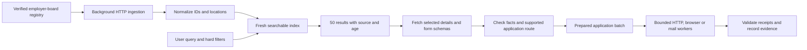

# ApplyBurst: architecture decision, 16 October 2026

The default product is a CPU-only job index plus a deterministic application executor. An ordinary laptop needs no model, GPU, n8n instance, or browser agent to search. A browser is started only for applications that need a website session.

The defensible first promise is **“Find 50 matching indexed jobs in seconds.”** The eventual application promise must specify supported sites and measure confirmed receipts. Fifty discovered jobs, fifty queued tasks, fifty filled forms, and fifty employer-confirmed applications are separate outcomes.

## 1. Find jobs without putting crawling on the search path

**Use public structured ATS feeds first.** Greenhouse, Lever, and Ashby are implemented. One board response can contain hundreds of jobs. LinkedIn/JobSpy is a supplemental discovery source, isolated from interactive search. Our single JobSpy probe returned only 20/50 results after a rate-limit warning; it cannot carry the latency guarantee.

**Keep a registry.** These ATS feeds are company-specific; they are not global search APIs. The baseline registry contains nine explicitly identified boards, including four Turkish employer boards. It is a seed, not broad job-market coverage. Expand it offline from company career links, existing public registries, and archive indexes, then validate each live board. Handle company migrations and regional ATS hosts; a stale slug is not proof a company has no vacancies.

**Keep search available during refresh.** The Python index exposes results as sources finish. The website keeps the current index queryable until a refreshed snapshot is ready; its two ingestion workers have an 18-second per-source deadline and a 25-second total budget. The full-description Python exporter uses a 20-second individual deadline. These are request budgets, not refresh guarantees: scheduling, parsing, and network failures add variability. A failed source retains its previous snapshot and original observation age.

**Fetch full descriptions before detailed search.** Title-only metadata cannot answer a query about PostgreSQL, qualifications, or distributed systems hidden in the description. V2 ingests complete descriptions in the background, including Lever requirement/responsibility lists and additional text. The observed Stripe full-description response was 12.46 times the decoded metadata size; pay this cost once per source refresh, rather than once per user search. Fetch selected application question schemas on demand. The simpler title benchmark remains historical evidence, not the current detailed-search latency claim.

**Cache with correctness.** Store provider, board, external ID, source URL, observed time, active state, and revision headers. The Python core uses ETag/Last-Modified and content hashes; its cache representation includes the normalizer revision and requested content variant, preventing a metadata 304 from preserving incomplete descriptions. The website stores a shared snapshot in R2 and keeps per-job observation ages; it currently refetches full feeds on an explicit refresh. Remove disappeared jobs only after a successful complete board snapshot. Freshness filtering is explicit in the demo; stale records are otherwise visible with their age. Observation and original posting date are separate facts.

**Do not count duplicates as jobs.** The posting key is `(provider, board, external_id)`. V2 also preserves Greenhouse's internal requisition identity and collapses multiple matching postings for that requisition after filtering/ranking. The bundled 1,892 postings represent 1,850 opportunities; result counts and batch selection use the latter identity. Preserve different locations on the individual postings. Cross-source canonical link resolution is still required before combining LinkedIn with ATS feeds; title/company equality is insufficient.

## 2. Matching without generative inference

The Python CLI/API retain SQLite FTS5 prefix search; the CLI defaults to title matching with full text optional. The website has a separate shared CPU engine supporting AND/OR/NOT, parentheses, phrases, and title/description/skill/company/location/workplace/level/type/source fields. Invalid syntax returns an error rather than silently broadening the search. Weighted BM25 ranks lexical evidence and returns snippets from the matching source fields.

Structured filters apply workplace, seniority, location, all requested technology mentions, employment type, annual USD salary minimum, and observation age. Missing salary or seniority stays unknown; a missing level never becomes junior. Known Turkish cities map to Turkey for retrieval, while workplace provenance distinguishes explicit metadata from conservative text inference. A remote label does not establish worldwide work eligibility. Technology mentions do not establish that every listed skill is mandatory, and a high score is not a candidate-fit probability.

The Web Worker keeps indexing/query work off the UI thread. It loads a prebuilt inverted index only when the revision and posting identities match; a changed live catalog rebuilds locally. Both paths are tested for equivalent results. Canonical requisition collapse happens after filters, so a matching location is retained instead of choosing an arbitrary duplicate first.

Cheap ranking order: exact terms and synonyms → BM25 → optional small static embeddings or a trained classifier over a shortlist. Encode each changed job once in the ingestion worker if embeddings prove useful. Never use a 50-request LLM loop to rank 50 results.

Count search quality as well as latency: unique results, freshness, relevant titles, geographic constraints, supported application destinations, and recall against a manually reviewed target list. Our public probes demonstrate retrieval throughput, not personal fit or market-wide recall.

## 3. Apply through the cheapest verified route

Resolve each selected job to a capability record before promising it is ready:

| Route | Execution | What must be known |
| --- | --- | --- |
| Documented submission API | Pooled HTTP requests | Applicant-usable credentials and complete required fields |
| Known hosted form | Reusable browser workflow | Session, upload behavior, schema version and confirmation condition |
| Explicit application email | Mail transport and a rendered template | Verified application address, approved content and delivery state |
| Unknown form or question | Collect schema and request missing facts | A tested adapter or reviewed new mapping |

Public listing APIs do **not** imply public applicant submission APIs. Greenhouse and Lever document employer-side authentication for their POST endpoints. The application baseline uses project-owned sandbox receivers; it does not claim those endpoints are universally available to job seekers. See the [Greenhouse](https://docs.greenhouse.io/job-board.html) and [Lever](https://github.com/lever/postings-api#apply-to-a-job-posting) documentation.

For a known form, extract labels, types, options, required fields and uploads. The demo implements public read-only Greenhouse question inspection with a one-hour R2 cache; alternate resume file/text controls count as one required question group. Custom, consent, demographic, and unknown questions stay unresolved. One inspected Stripe role had 23 required groups and 18 needing candidate answers; recognizing five identity fields did not make it ready to submit. Lever/Ashby forms explicitly return browser-inspection-required.

Future adapters map these schemas to approved candidate facts and an answer bank. Cache mappings rather than candidate values or session tokens, and invalidate on required-field/type/option changes. A classifier may help identify an unfamiliar field; it cannot supply an unknown visa, salary, consent, or authorization answer.

Run one browser process with **two reusable contexts by default** on laptops. Benchmark higher concurrency separately. HTTP workers can be more numerous, but concurrency and request-start rate are separate controls. Respect a provider's actual limit scope. A single 2-POST/second bucket requires at least 24.5 seconds to start 50 requests, before the final response; parallel tabs cannot remove that bound. Lever documents a 2-POST/second limit for custom job sites; the baseline includes a separate paced fixture run rather than hiding this constraint. [Lever rate-limit documentation](https://github.com/lever/postings-api#post-application-rate-limit).

Use explicit readiness checks instead of unconditional sleeps. Upload prevalidated documents. Wait for a provider-specific confirmation, not just a button click or HTTP 200. Persist claims before sending; deduplicate by candidate and canonical job. A timeout after a possible side effect becomes `unknown` and needs reconciliation. Do not blindly retry it. The baseline ledger implements persistent claims, conservative unknown outcomes and explicit recovery of interrupted work; it is not a distributed exactly-once queue.

For email, a template can produce useful tailored mail from known company, role and candidate facts without any model. Generative rewriting is optional and outside the submission path. SMTP acceptance means the mail server accepted the message; it does not prove inbox delivery, recruiter review, or an ATS application.

## 4. Deployment that fits laptops

Offer two implementations of the same interfaces:

- **Hosted index plus local session executor:** shared ingestion and indexing run once; the laptop uses a lightweight web UI and a local browser extension/helper for authenticated forms. Candidate/session data stays in the local execution boundary where practical. Remote index access does not require local GPU hardware.
- **Self-hosted/local mode:** the Python CLI and SQLite index refresh selected boards. The website currently distributes a compressed full-description snapshot and prebuilt index for its nine-board demo, with safe local rebuilding after refresh. At market-wide scale, use shared server retrieval and fetch only matching snippets/details; do not distribute millions of full descriptions to every browser.

Keep components as Python libraries plus a small API; orchestration is ordinary async code. SQLite is sufficient for the baseline. Move the shared service to Postgres plus a durable worker queue only when multi-user load or operational requirements justify it. UI, CLI and future extension call the same discovery/preparation/execution contracts. No n8n dependency is present.

## 5. What is built and what remains

Implemented: three full-description ATS normalizers; nine-board registry; bounded ingestion and failure-preserving caches; conditional refresh in Python; rich field/Boolean search in a CPU Web Worker; revision-checked prebuilt index; conservative facts and match snippets; repeated-requisition collapse; real Greenhouse question inspection; synthetic email templates; local HTTP/browser/SMTP execution fixtures; and the hosted responsive demo with D1 receipts and R2 cache.

The website's application receiver validates actual multipart bytes and six fixed answers. It inserts an idempotent owner/run/job receipt, rereads it, and returns its SHA-256. The client separately rereads all receipts for the run and checks job identities, receipt IDs, states, and uploaded hashes. Submission and final verification times are recorded separately. Unknown outcomes remain visible. This is a sandbox protocol, not proof of a real ATS adapter.

Not implemented: market-wide board discovery; cross-source deduplication; candidate eligibility evaluation; real employer submission adapters; production form-plan invalidation; authenticated local session management; and personal email delivery. There is no model dependency or completed model benchmark, and the actual laptop has not been tested.

Next sequence: judge detailed-query relevance and laptop resource use → validate one real hosted-form adapter → expand supported forms and explicit mail routes. The demo is usable now; public “50 real applications in seconds” copy still waits for evidence on that supported set. No n8n or per-click inference loop is needed for any implemented stage.
